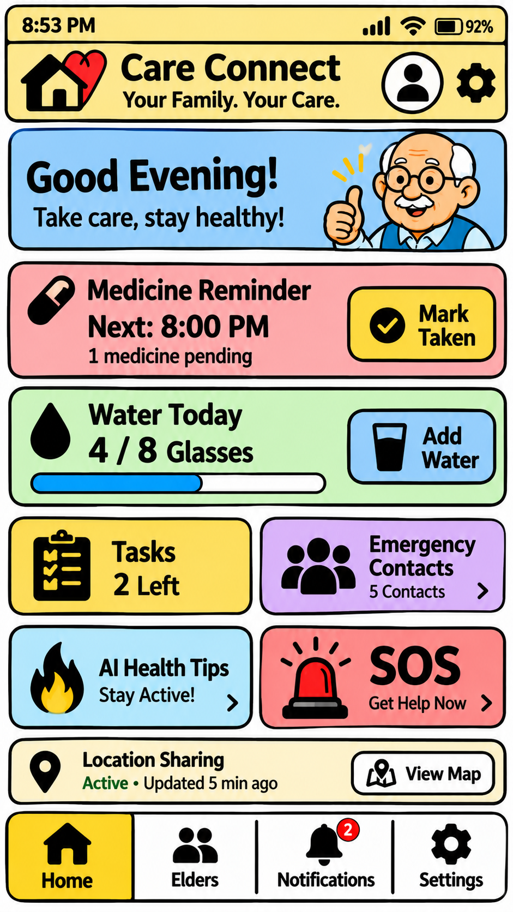
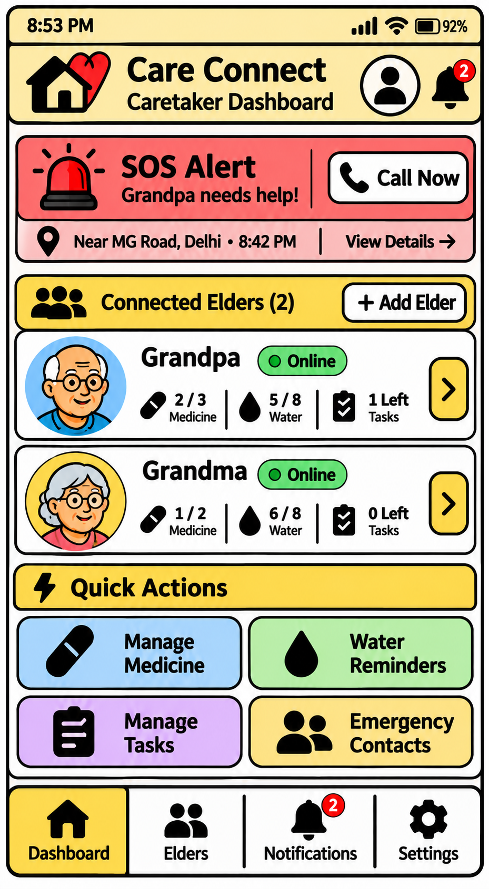
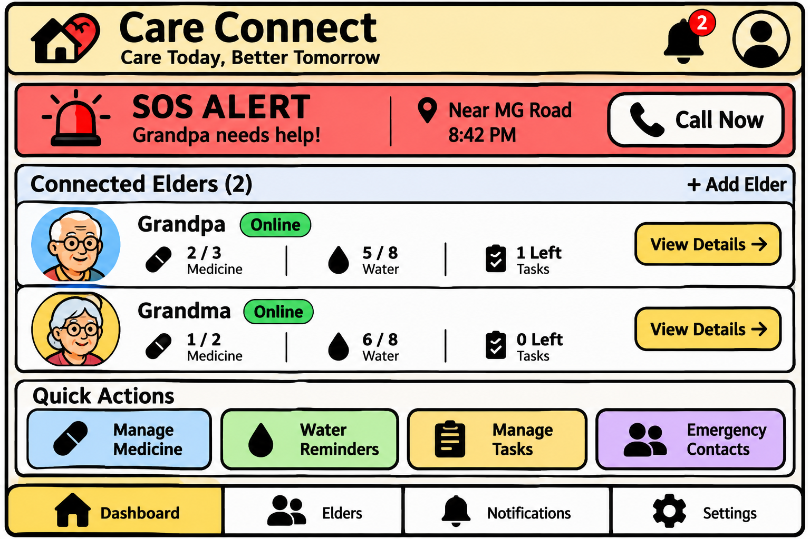
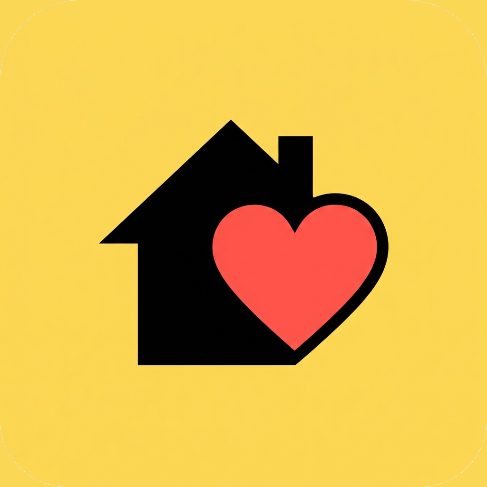
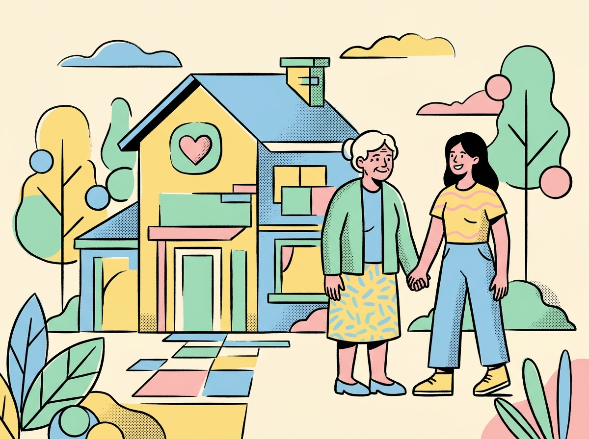

# Care Connect

**Care Connect** is a Neo-Brutalist, elder-friendly Android application built with Kotlin and Jetpack Compose that connects older adults with their authorized family caretakers. It helps families coordinate daily medicine reminders, hydration tracking, daily tasks, appointments, emergency contacts, video check-ins, fall detection alerts, and SOS workflows with offline-tolerant local persistence and real-time cloud synchronization.

---

## Download APK

- **Direct Debug APK (Included Build Output):** [Download `app-debug.apk`](.build-outputs/app-debug.apk)
- **Build Locally from Source:** Run `gradle :app:assembleDebug` to generate `app/build/outputs/apk/debug/app-debug.apk` (or generate a signed release APK/AAB via Android Studio's **Build → Generate Signed Bundle / APK**).
- **Install on Android Device (e.g., Motorola Moto G35):** Download `.build-outputs/app-debug.apk` to your phone and open it to install (or run `adb install .build-outputs/app-debug.apk` over USB debugging).

---

## Screenshots & UI Previews

> **Note:** Below are the bundled UI design previews and illustration assets from this repository. Live runtime screenshots can be captured directly from an Android device or emulator.

| Elder Home Dashboard | Caretaker Dashboard | Wide / Tablet Reference |
| :---: | :---: | :---: |
|  |  |  |

| App Icon | Onboarding Care Illustration |
| :---: | :---: |
|  |  |

---

## Key Features

### Dual-Role Experience (Elder & Caretaker)
- **HashRouter-Driven Primary Navigation**: Top-level `NavHost` synchronized with `HashRouterState` (`#/splash`, `#/auth`, `#/elder/dashboard`, `#/caretaker/dashboard`) to manage transitions across Splash/Onboarding, Google Authentication, the Elder Home Dashboard, and the Caretaker Dashboard.
- **Consent-Based Family Linking**: Elders generate private 6-character pairing codes (`pairing_invites`) and can review or revoke linked caretakers at any time (`caretaker_links`). Caretakers can link via pairing code or manage family elder profiles.

### Elder & Caretaker Care Modules
- **Prescription-Entered Medicine Reminders**: Track scheduled doses (`active` / `paused`), mark reminders as `taken` or `skipped` with confirmation dialogs, and schedule local notifications.
- **Daily Water Intake Tracker**: Visual progress tracking against configurable daily glass goals.
- **Daily Tasks & Appointments**: Assign and check off care tasks, manage clinic/doctor visits, and enable visit reminders.
- **Emergency Contacts (5+ Recommended)**: Priority-ordered trusted contacts with confirmation-gated `ACTION_DIAL` quick dialing.
- **SOS Emergency & Permitted Location Sharing**: Confirmation-gated SOS alerts delivered to linked caretakers with acknowledgment/cancellation states and optional coarse area sharing only when enabled and permitted.
- **AI Daily Wellness Tips**: General lifestyle wellness suggestions generated via Firebase AI Logic (`Firebase.ai`), accompanied by a non-medical advice disclaimer.

### Video Calling & Fall Detection
- **Authorized Video Calling (`VideoCallScreen`)**: Member-gated call sessions between elders and linked caretakers featuring real-time Firestore signaling (`video_calls`), a global incoming-call banner (`Answer` / `Decline`), live CameraX local camera preview, front/back camera switching, mic mute sync, and speakerphone/earpiece audio routing.
  - *Note*: Encrypted session signaling, call state sync, and local CameraX preview run in-app; two-device remote audio/video streaming requires dedicated WebRTC TURN media relay infrastructure.
- **Fall Detection Sensor & Auto-SOS (`FallDetectionMonitor`)**: Monitors real device `Sensor.TYPE_ACCELEROMETER` telemetry using configurable sensitivity thresholds (`Low 3.2G`, `Medium 2.6G`, `High 2.1G`) and includes an explicit **Safety Simulation Mode** for safe testing. Triggered events start a 15-second pre-SOS countdown dialog (`I'm Okay — Cancel` or `Send SOS Now`) before dispatching an SOS alert with impact metadata and permitted location.

### Accessibility, Design & Offline Tolerance
- **Neo-Brutalist Elder-Friendly UI**: Thick high-contrast outlines, pastel surface blocks, clear black iconography, >=48dp touch targets, and non-color-only status badges.
- **Themes & Font Scaling**: Selectable **Classic Pastel**, **Warm Cream**, and **High Contrast** presets, Dark Mode toggle, and **Normal / Large / Extra Large** text scaling stored in Jetpack DataStore.
- **Offline-Tolerant Storage**: Room local cache + pending sync queue (`PendingSyncOpEntity`) paired with Cloud Firestore snapshot listeners and zero-trust `firestore.rules`.

---

## Tech Stack

| Layer | Technology |
| :--- | :--- |
| **Language & UI** | Kotlin, Jetpack Compose, Material Design 3 |
| **Architecture** | MVVM (`CareViewModel`), StateFlow, Coroutines, Repository pattern |
| **Navigation** | AndroidX Navigation Compose (`NavHost` + `HashRouterState`) |
| **Authentication** | Firebase Authentication + Google Sign-In via Jetpack `CredentialManager` |
| **Cloud Backend & AI** | Cloud Firestore (`firestore.rules`), Firebase App Check, Firebase AI Logic (`Firebase.ai`) |
| **Local Storage** | Room Database (offline cache & sync queue), Jetpack DataStore Preferences |
| **Hardware & Media** | CameraX (`camera2`, `core`, `lifecycle`, `view`), `SensorManager` (`TYPE_ACCELEROMETER`), `AudioManager`, Play Services Location (`ACCESS_COARSE_LOCATION`) |
| **Testing** | JUnit 4 (`ExampleUnitTest.kt`), Firestore Rules Emulator tests (`firestore.test.js`) |

---

## Project Structure

```text
Care Connect/
├── app/src/main/java/com/example/
│   ├── MainActivity.kt              # Edge-to-edge entry point & App Check initialization
│   ├── data/
│   │   ├── local/                   # Room entities, DAOs, database & UserPrefsDataStore
│   │   └── repository/              # CareRepository (Firestore + offline sync) & AiWellnessRepository
│   ├── firebase/                    # Credential Manager Google Sign-In & App Check setup
│   ├── location/                    # Permission-gated coarse location helper
│   ├── model/                       # CareModels (ElderProfile, Medicine, SosEvent, VideoCallSession, etc.)
│   ├── notifications/               # Notification channels & reminder scheduling
│   ├── sensors/                     # FallDetectionMonitor (accelerometer + Safety Simulation Mode)
│   ├── ui/
│   │   ├── components/              # Neo-Brutalist buttons, cards, badges, nav bar & rail
│   │   ├── navigation/              # CareHashRouter.kt & CareNavigation.kt
│   │   ├── screens/                 # Splash, Onboarding/Auth, Dashboards, Modules, Video Call, Fall Detection
│   │   └── theme/                   # Color tokens, themes (Classic Pastel, Warm Cream, High Contrast), typography
│   └── viewmodel/                   # CareViewModel managing UI state, sync, fall countdown & call actions
├── app/src/test/java/com/example/
│   └── ExampleUnitTest.kt           # Unit tests for models, themes, and HashRouter transitions
├── firebase-blueprint.json          # Firestore schema specification
├── firestore.rules                  # Member-gated zero-trust Firestore security rules
└── firestore.test.js                # Local Firestore Emulator security rule test suite
```

---

## Getting Started

### Prerequisites
- Android Studio (with Android Gradle Plugin 9.1.1+ / JDK 11+)
- Android SDK (`minSdk 24`, `compileSdk 36`, `targetSdk 36`)
- A Firebase project configured with Authentication (Google Sign-In), Cloud Firestore, App Check, and Firebase AI Logic (`app/google-services.json`)

### Build & Run
1. Clone the repository and open the root folder in Android Studio (or build via Gradle CLI).
2. Ensure `app/google-services.json` is connected to your Firebase project and deploy `firestore.rules`:
   ```bash
   firebase deploy --only firestore:rules
   ```
3. Run unit tests:
   ```bash
   gradle :app:testDebugUnitTest
   ```
4. Build the debug APK:
   ```bash
   gradle :app:assembleDebug
   ```
5. Optionally run Firestore security rule tests against a local Firestore Emulator:
   ```bash
   FIRESTORE_EMULATOR_HOST="127.0.0.1:8085" node --test firestore.test.js
   ```

---

## Developer Profile

**Sagar Kushwaha** (`SK`)  
*Aspiring Indie Game Developer · B.Tech CSE Student · Programmer in Progress*

| Detail | Information |
| :--- | :--- |
| **Full name** | Sagar Kushwaha |
| **Location** | Jabalpur, Madhya Pradesh, India |
| **Education** | B.Tech, Computer Science — Gyan Ganga Institute of Technology and Science (GGITS) |
| **Academic year** | First year (as of 2026) |
| **Career interest** | Indie Game Development |
| **Primary game engine** | Unity |
| **Future game engine** | Unreal Engine |
| **Programming level** | Beginner / Learning |

### Programming Languages & Technologies (Learning Profile)
> **Note:** The table below reflects technologies currently being learned and explored, not claims of professional proficiency.

| Technology | Status |
| :--- | :--- |
| **Python** | Learning |
| **C++** | Learning |
| **JavaScript** | Learning |
| **HTML** | Web development learning |
| **CSS** | Web development learning |
| **C#** | Learning for Unity |
| **Unity** | Primary game engine |
| **Unreal Engine** | Future learning goal |
| **React** | Exploring for application development |
| **Vite** | Exploring for web applications |

### Interests & Career Goals
- **Game Development**: Indie game development, story-driven games, simulation games, mystery and fantasy games, 2D & 3D game development, mobile games, interactive storytelling, stylized and realistic graphics, and lightweight games optimized for lower-end hardware.
- **Software Development**: Android application development, web development, desktop applications, offline applications, AI-powered applications, student management systems, and utility applications.
- **Other Interests**: Video editing, digital design, UI/UX design, creative technology, AI-assisted programming, and learning new programming languages.

---

## Development & Testing Environment

Hardware specifications and engineering priorities considered during testing and optimization:

| Component | Setup |
| :--- | :--- |
| **Processor** | Intel Core i5, 4th Generation |
| **RAM** | 16 GB |
| **Storage** | 500 GB |
| **Graphics** | Integrated graphics (32 MB reported graphics memory) |
| **Operating system** | Windows 10 64-bit |
| **Mobile device** | Motorola Moto G35 |

### Development Preferences
- Prefer lightweight applications that perform well on lower-end hardware.
- Avoid unnecessary dependencies and keep setup/installation straightforward.
- Support practical offline functionality where appropriate.
- Prioritize usability, accessibility, and clean high-contrast interfaces.
